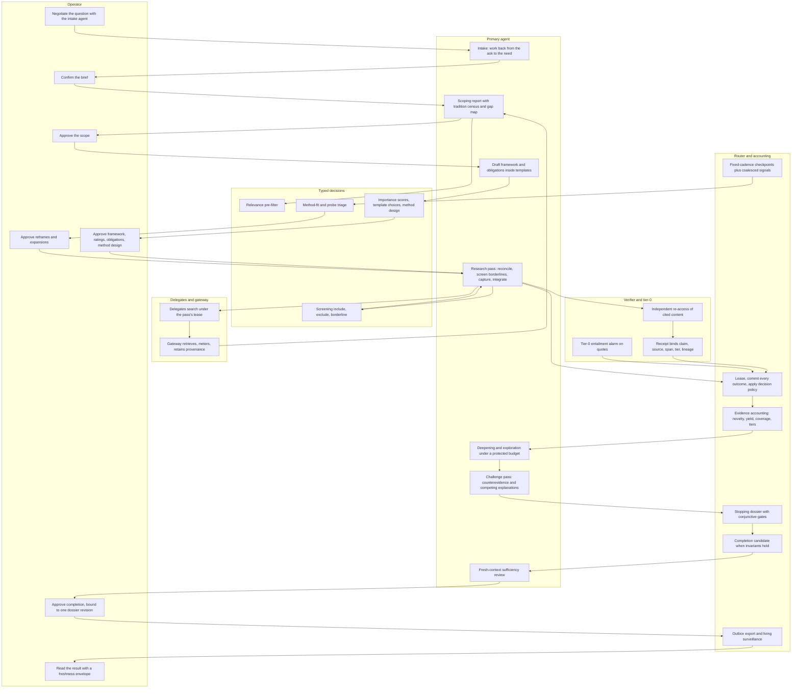
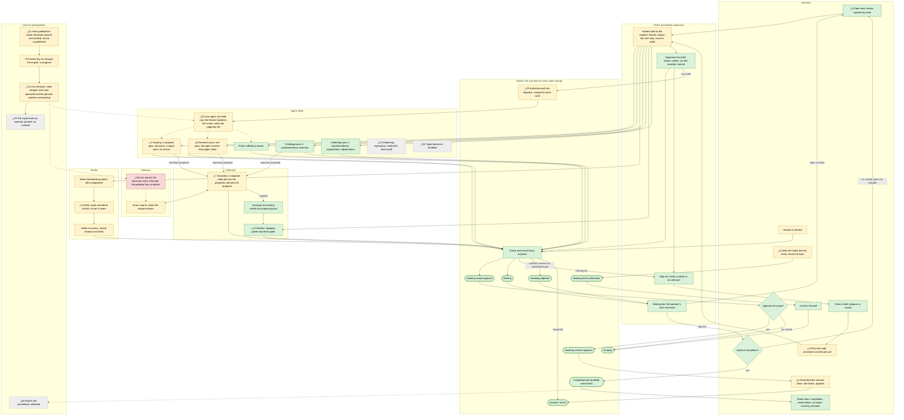

# Gen-2 research process map, v2 (2026-11-12): what should happen against what actually happens

**Purpose.** A process map of the research flow, to check what is actually happening against what should happen: to spot issues, chances to simplify, and places where steps are not connected or are missing. It is re-checked at every Gate S and after every end-to-end run. v1 was written on 2026-11-07; this version re-reads every step against the merged code and the two runs since.

**How to read it.** §1 is the intended process, one diagram. §2 is the process as built and as observed, one diagram, then what the offline end-to-end run and the native host run actually did. §3 is the centre: the *should vs actually* table, one row per step, with the step's status now and in v1. §4 the hand-offs, §5 the legend, §6 the gaps and simplifications, §7 the operator's live path to the first supervised topic, §8 which v1 gaps closed and by what. §9 (private sources) is dropped from the repository copy.

**Read against:** the merged `gen2` branch at `35a3b52` (2026-11-11, PR #175). Everything that v1 read from accepted-but-unmerged pull requests is now merged, together with the offline end-to-end run (#159), the live path stack (#151, #152, #153, #155, #157, #158, #161, #164 and the L5–L8 follow-ups #168, #170, #172, #173) and the host fixes #162–#174. **Two things have run:** the offline whole-workflow test, through production routes on a fresh store, to an approved completion; and the host's native qualification sequence on the dedicated daemon, accepted by an independent verifier. **No topic has run live, and no model has yet made a judgment.** The fixture dry run through the engine (T10) started on 2026-11-12 and is mapped as in progress.

---

## 1. What should happen

Unchanged from v1: the flow architecture (stages S1–S8) and the methodology synthesis. Every hand-off crosses a typed artifact; code decides everything computable; a typed-decision model selects among enumerated options; agents read, generate and judge; the operator owns scope, framing and completion.

**In words.** S1 intake negotiation produces a confirmed brief. S2 scoping maps the territory and its traditions; the operator approves the scope. S3 the agent drafts a hash-locked contract inside templates, scored by the decision model, approved whole by the operator. S4 research passes run under leases: reconcile pending, discover through delegates, screen (code, then the decision model, then the agent), capture with exact quote matching and a tier-0 alarm, integrate, commit; a separate verifier re-accesses cited content and a load-bearing claim becomes accepted support only with its receipt. S5 checkpoints run on a fixed cadence plus signals. S6 deepening and a protected exploration budget, then the challenge pass. S7 evidence accounting assembles the stopping dossier; the Router forms a completion candidate; a fresh review judges sufficiency; the operator approves against that exact revision. S8 export through one outbox and living surveillance.

---

## 2. What actually happens

The process as built at `35a3b52` and as observed in the two runs. Each △ marks a difference from §1 and names its row in §3.

### 2.1 What the offline end-to-end run did (T18, merged as #159)

The whole-workflow test drives one topic on a fresh store with the production station, Router, supervisor, driver, child, builders, views, recorders and discovery client. Only the model and the gateway are canned (a fixture agent with fixed judgments, a canned gateway). The operator's steps are Router commands between the driver's waits: record the topic and brief; confirm the brief; approve the scope; draft the contract, rate it, draft again, approve; open a review episode; approve completion. The oracle is the Router's own records and status read back afterwards.

The observed walk now runs to the end: brief → confirm → scoping (a proposal pass, one discovery job, a report pass) → scope approval → contract (two drafts, a rating, an approval) → one research pass → one discovery job → verification → review opened by the operator → challenge pass 1 → discovery → challenge pass 2 → dossier (**all three gates satisfied**) → sufficiency review (`sufficient`) → **the Router moves the topic to awaiting judgment** → the operator approves → **completed with qualified conclusions**. The record families read back: 1 scoping report, 2 works, 1 claim, 1 claim-source link, 1 source artifact, 1 acquisition, 1 verification receipt (abstract tier, canonical bytes, `supports`), 4 detailed checks, 1 matched quote check, 2 completion records (counterevidence search, sufficiency review), 3 search observations each stamped with its proposal. The negative test shows that removing any of the three recorders refuses the run.

Three limits the reviewer recorded, which this map carries forward: the stopping profile is a substitute (one automatic known-item rule over a staged sentinel), because the example profile's reviewed-judgment and window rules have no automatic evaluator; the sufficiency review is a fixed `sufficient` answer, so review adequacy is unproven; and the fixtures are schema-shaped, not replays of retained artifacts. The three "required failures through production routes" were dropped from T18 by decision; the recorder-missing refusal is the only negative.

### 2.2 What the native host run did (T9, 2026-11-11)

On the dedicated rootless daemon, from the merged tree at #174: the engine, gateway and database were brought up by the pinned Compose plugin from the reviewed compose files (the first time those files ran); the manifest gate ran inside the production engine image; the production Docker backend created, started and ended the initializer, the relay and the runner; the pinned Codex binary in the production runner made two real requests to the model fixture through the relay and ran the isolation probe as its tool call (Q1–Q3, 17 denials, exact counter predicate); the normal end and a supervised deadline containment were witnessed in the original container scope (Q8); the accepted, rejected and tool-less fixture cases ran (Q11); the relay's TLS positive and two refusals ran on the pinned nginx image. An independent verifier re-derived every check and accepted the receipts with nine non-blocking gaps.

What did **not** run natively: the station, the Router's dispatch authorization, the child, the supervisor and the walk. The backend was driven by an operator harness subclass of the production backend, not by a live order. The qualification record is still `unqualified`; the fixture-route record is prebuilt and its publication was deferred to T10 so that it binds to a fixture that exists.

Two process findings from that window, both now Gate S candidates: (a) the host ran a hand-authored relay configuration and a hand-authored manifest that matched no committed source, so four native windows were disqualified and had to be rerun on reviewed operands; (b) the operator harness repeatedly ran outside the production execution context (five context stops, then two name-collision stops in its own code). The remedy ruled for the manifest was a pure builder that emits every case's plan, manifest and seed by hash before any Docker call.

### 2.3 T10, the fixture dry run through the engine (in progress)

Started 2026-11-12 03:00 UTC with read-only preconditions. Its sequence: exact-ID cleanup of the retained actors; a fresh fixture; fill and verify the record; publish it protected and set the pin; apply the live compose override; a new engine process; confirm the load and a real-route refusal; submit one fixture-route order through the production operator entry point; retain the Router's authorization and charge, the plan, the container identities, the end proof, the collected result and what the operator sees; restore. **Expectation worth setting now** (inferred from the code): the fixture answers with prose, not a judgment document, so the child will refuse the judgment and the step will end `failed` with a confirmed end and a worst-case charge. That is the correct outcome of the dry run, not a defect; the first real judgment can only come from a real model.

---

## 3. Should vs actually

Evidence: **code** (read in the clone at `35a3b52`, file named), **run** (the T18 test and the T9 receipts as reported and verified; not re-run here), **review** (a reviewer's or verifier's finding), **inferred** (my conclusion). Status: see §5. The status column shows v1 → v2.

| # | Step | Status (v1 → v2) | What should happen | What actually happens | Evidence | Fix, or simplify by |
|---|---|---|---|---|---|---|
| 1 | Topic start and intake brief **△1** | partly → partly | An intake agent works backward from the ask to the need; a completeness gate; the operator confirms a versioned brief. | The operator writes the brief as JSON against the schema and records it with two commands. No conversation, no template, no gate beyond the schema. Unchanged since v1 (deferred, DEBT-049). | code: `gen2/router/amendments.py` unchanged since v1; run: T18 `intake` | Ship the harness's brief as an operator template and a validate-only client mode. *Inferred.* |
| 2 | Brief confirmation | working → working | An explicit versioned act; unconfirmed briefs cannot advance. | As intended. | code: `gen2/router/service.py` `_apply_decision`; run: T18 | None |
| 3 | Scoping **△3** | partly → partly | Breadth-first mapping with a tradition census, a relevance pre-filter, per-lane coverage facts, a gap map. | A proposal-only pass, one discovery job, then a report pass; one report recorded. No census, no pre-filter; gap-map facets read `unknown`. | code: `gen2/exec/scope.py`; run: T18 (1 scoping report, 3 search observations across the walk) | None now; the census is a prompt change when the intake conversation lands. |
| 4 | Scope approval | working → working | Approve; rejection reworks. | As intended: approve, reject (back to scoping), defer. | code: `_apply_decision`, `_rework`; run: T18 | None |
| 5 | Contract construction and approval **△5** | partly → partly | The agent drafts inside templates; the decision model scores importance; the operator approves everything together; code checks matrix coverage. | The operator hand-drafts revision 1, records ratings, hand-drafts revision 2 carrying them, approves. **New:** the stopping profile must be one the evaluator can compute: it evaluates `known_item` and `coverage` rules; a `descriptive` rule always reads `unknown`, and reviewed-judgment rules have no evaluator. T18 substituted a known-item rule over a staged sentinel. | code: `gen2/accounting/stopping.py` (three evaluators), `gen2/tests/offline_world.py`; review: T18 acceptance | Templates and a validate-only mode (row 1). **Decide the live topic's stopping rule before the contract is drafted** (operator). Simplify: approve one operator-authored rated draft instead of two. *Inferred; amends G-2.* |
| 6 | Research pass **△6** | partly → partly | Reconcile pending; delegates discover; deterministic predicates, then the decision model, borderlines to the agent; exact quote matching plus tier-0; lifecycle decisions. | One pass (`max_passes` 1). The agent screens and judges alone from a view of the contract, obligations and works; writes claims, screening, triggers and proposals; rests. No predicates, no decision model, no tier-0. | code: `gen2/exec/research.py`, `gen2/app/workflow.py`; run: T18 | None for the first topic (D-7). |
| 7 | Discovery, offline route **△7** | partly → partly | Delegates under the pass's lease; every search records identity, coverage and yield. | A separate supervised code job per proposing pass runs the receipt-verified proposals through the gateway client; a recorder writes observations, works and retained bytes stamped with the proposal; **the order carries its proposer, and the Router binds it at admission.** Lanes are a constant in the hosted walk (one lane) and in the harness (two); the topic draft names three. | code: `gen2/discovery/child.py`, `gen2/router/search_capture.py`, `gen2/app/driver.py:245`, `gen2/app/walk.py:25`; run: T18 (3 attributed observations) | Read the lanes from the active bundle. The live route is row 26. |
| 8 | Verification **△8** | partly → partly | Hybrid inline and sampled; tier-0 alarm; a receipt binding claim, source version, span, tier, lineage; role separation; disagreement as a typed hold. | Every provisional load-bearing claim with retained source and no accepted support is selected; a separate invocation re-reads the retained bytes, writes a receipt, four detailed checks and a quote check; the Router refuses self-verification. No sampling tier, no tier-0. A quote crossing a JSON escape is refused. | code: `gen2/exec/verify.py`, `verify_record.py`, `spans.py`, `gen2/router/support.py`; run: T18 (1 receipt, abstract tier, matched quote) | Later: verify against the abstract as a staged text artifact and delete the span module (roadmap D). |
| 9 | Checkpoint opening **△9** | working → working | A cadence floor plus a coalesced signal queue. | The operator opens every episode; `raise_signal` has no production caller. Deferred (DEBT-045). | code: `gen2/router/scheduling.py`; run: T18 `open_review` | None. |
| 10 | Challenge pass | partly → **working** (offline) | Bounded counterevidence search and one competing-explanation test per contradiction, before any completion candidate. | As intended, in two passes with a discovery job between; "none found" needs every proposed search clean and complete. The challenge gate reads satisfied. | code: `gen2/exec/challenge.py`; run: T18 (counterevidence record, gate satisfied) | None |
| 11 | Deepening, exploration, method-fit, facet audit **△11** | not built → not built | Coverage-adequate topics deepen; a protected exploration budget; method-fit review and a facet audit at checkpoints. | Nothing. Phase 3 (DEBT-044/046/047). | code: no module | None now; the first dossier must say so. |
| 12 | Dossier and stopping **△12** | working → working | Evidence accounting assembles the dossier against the declared profile; conjunctive gates; `unknown` never reads as zero. | As intended: a code job records the dossier; three gates (verification tiers, challenge completed, coverage integrity) all satisfied in T18. **Caveat:** satisfied only under an automatically evaluable profile (row 5). | code: `gen2/exec/dossier.py`, `gen2/accounting/stopping.py`, `gen2/router/gates.py`; run: T18 | Cut or finish the `descriptive` evaluator (it can only answer `unknown`). *Inferred.* |
| 13 | Fresh sufficiency review | partly → **working** (offline) | A fresh-context review of substantive sufficiency. | A different invocation reads one exact dossier revision and records `sufficient` or `insufficient` with evidence; the Router refuses the producer. The offline reviewer is a constant `sufficient`, so adequacy is unproven. | code: `gen2/exec/review.py`; run: T18; review: T18 acceptance limits | None now; pre-committed stop rules in the runbook (row 23). |
| 14 | Coverage accounting | **not connected → working** | A pass's window is credited with the searches it caused. | The driver sets the discovery order's requester to the proposing pass; the Router binds it at admission from the committed outcome; accounting counts a bound execution in the proposer's window. The coverage gate reads satisfied. | code: `gen2/router/search_capture.py`, `gen2/accounting/__init__.py` `_window_searches`; run: T18; review: #149 | None. v1 gap 2 closed. |
| 15 | Completion approval | **not connected → working** | The Router assembles a candidate when invariants hold; the topic awaits judgment; the operator approves against the exact revision. | On a committed sufficient review of a satisfied, fresh dossier with no open hold, trigger or unfinished invocation, the Router moves `resting → awaiting_judgment`; approval is accepted from there and binds the revision. A rejection is recorded; explicit rework opens an episode and queues once. Suppressing the candidate reproduces the old refusal (killed mutant). | code: `gen2/router/completion.py`, `service.py:961–967`, `01-queue-and-contracts.sql:115`; run: T18; review: #152 | None. v1 gaps 1 and 9 closed. |
| 16 | Result read | working → working | A freshness envelope with export delivery and surveillance currency. | The status read: completion with its dossier revision, the review block (gates, each review's outcome, summary, evidence), `export_delivery: not_attempted`, `currency: unknown`. The driver and the walk client print the same block. | code: `gen2/router/status.py:129`, `gen2/core/review_presentation.py` | None (DEBT-043). v1 gap 10 closed. |
| 17 | Holds and stops | working → working | Typed holds; silence is never success. | As intended at the Router and supervisor; the driver stops on any hold and clears nothing; a stopped walk tells the operator what to do. | code: `gen2/router/lifecycle.py`, `gen2/supervisor/supervisor.py`, `gen2/app/run_topic.py` `STOPS` | None before unattended hardening (DEBT-055). |
| 18 | Amendment and reframe | partly → partly | A reframe versions the facet map, marks pinned work stale, reopens exclusions. | The Router side exists; the driver stops on unsettled old work. Still never exercised by a walk. | code: `gen2/router/amendments.py`, `gen2/app/driver.py` | Exercise once offline before the live run. |
| 19 | Advancing the work **△19** | **not connected → partly** | The Router schedules and the station advances; one engine, one writer. | The deployed engine hosts the walk: one driver tick per operator call, on the engine's owner thread; the client command loops the call until the next wait or a stop; replies are fixed words. Proven through a real engine only to the first operator wait; the whole walk is proven with the driver in-process (T18), not through the listener. Never run natively. | code: `gen2/app/walk.py`, `engine.py:87`, `run_topic.py`; run: `test_app_walk` (to first wait), T18 (in-process); review: #151 | T10 runs it through the listener. Simplify: drive T18 through the engine's `walk` route so one harness proves both. *Inferred.* |
| 20 | The agent itself **△20** | **not connected → partly** | A frontier model per station, in the isolated runner, reading typed input. | A model order with a plan makes the child run the production Docker backend for its own job; the runner copies the seed, builds the prompt and executes the pinned Codex binary with the judgment as its last message; the child validates the judgment file against the purpose's schema. Natively the backend ran under an operator harness, not through the child; the only model answers so far are the fixture's. **No real judgment exists anywhere yet.** | code: `gen2/app/live.py`, `child.py:84–85`, `deploy/gen2/live/runner.py:86`, `gen2/supervisor/docker_cli.py:341`; run: T9 (backend, runner, fixture) | None in code. T10 will end in a refused judgment by design (§2.3). The prompts must make a real model end with the judgment document exactly; unproven. |
| 21 | Host qualification **△21** | **not built → partly** | Qualified images, networks and isolation witnesses before any live order. | Q1–Q3, Q8 (normal end and deadline), Q11 (three cases) and TLS (three cases) passed natively on reviewed operands and were independently verified. The fixture-route record is prebuilt and unpublished (deferred to T10). The real-route record additionally needs the genuine rejection, the provider files and the egress bridge, and a re-pin after the host-path change (#176). | run: T9 receipts; review: verifier 2026-11-11 | Publish during T10. Fix the two process findings (§6 item 3) before the real-route record. |
| 22 | Live entrance **△22** | **not built → partly** | Real lanes through the gateway, a keyed provider with a spend ceiling, supervised only. | The authority loads the protected record and refuses otherwise; a live child starts only with the authority wired, the operator's per-call `live` flag and the Router's authorization of that dispatch; the Router records the result and charges the configured worst case when cost is unknown (always, today) and continues under the ceiling; an unknown end stops. Proven offline with a fixture backend (7 orders, 7 authorizations, 7 results). **Live search is not part of this: row 26.** | code: `gen2/supervisor/authority.py`, `supervisor.py:874–906`, `gen2/router/dispatch.py:304–308`; run: `test_live_integration`; review: #161 | T10, then the real-route operands (§7). |
| 23 | The supervised run **△23** | not built → not built | One topic end to end with the operator present and pre-committed stop rules. | No runbook. The host operations rows cover only the rejection window. | code: no file; `deploy/gen2/live/OPERATIONS.md` rows 29–30 | Write it from §2.1's observed walk, the T10 receipts and the operations rows. |
| 24 | Export and surveillance **△24** | not built → not built | One outbox, one connector, living surveillance. | Deferred to task 2g (DEBT-040–043). | code: `status.py:128` | None. |
| 25 | Automated decisions **△25** | not built → not built | A uniform ladder: code, decision model, LLM fallback, agent, operator. | Disabled throughout Phase 2 (D-7). | log: INVARIANTS §13 | None now. |
| 26 | Live discovery entrance **△26** (new) | — → **not connected** | Delegates search live lanes through the gateway under the pass's lease. | The discovery child's production entry refuses whenever no transport is injected ("the live gateway entrance is closed"), and the hosted walk orders exactly that entry with the gateway URL and token file in its environment, so **a live discovery order exits 2 and the walk stops at the first proposal.** The gateway container sits on an internal network named offline, so it has no egress either. Nothing in the live path stack touched this. | code: `gen2/discovery/child.py:91–93`, `gen2/app/walk.py:23,60–64`, `deploy/gen2/live/compose.yaml` (gateway networks, `research-egress-offline`, `internal: true`) | One production transport over the gateway URL and token file, opened by the same per-call `live` permission the model orders use; one egress network row for the gateway; lanes from the bundle. *Inferred: about 60 lines plus one approval row.* **This blocks the first research pass of any live topic.** |

**Counts:** working 10 · partly built 11 · not connected 1 · not built 4 (26 rows). **v1:** working 6 · partly built 9 · not connected 4 · not built 6 (25 rows).

---

## 4. Hand-offs per step

| # | Step | Who acts | Takes in (from step) | Hands off (to step) | Decisions and loops | What the operator sees |
|---|---|---|---|---|---|---|
| 1 | Topic start and brief | Operator | The question | Topic and brief awaiting confirmation (→ 2) | An overdue brief is marked, never advanced | Status: topic, brief versions, owner, deadline |
| 2 | Brief confirmation | Operator; Router | The brief (1) | Scoping (→ 19, 3) | Incompatible later version → back to scoping | The decision's reply |
| 3 | Scoping | Agent step ×2; discovery; Router | Brief, observations, latest report (19) | Report and proposals (→ 4; proposals → 7) | Up to 3 rounds; report commit → awaiting scope approval | The waiting line for scope approval |
| 4 | Scope approval | Operator; Router | Newest report (3) | Awaiting contract approval (→ 5); rejection → 3 | Approve / reject / defer | The report; the reply |
| 5 | Contract | Operator; Router | Approved scope; bundle templates | Approved revision; topic queued (→ 19, 6) | Draft, rate, redraft, approve; refusals on ratings, matrix, references; the stopping rule must be evaluable | Drafts in status; refusal reasons |
| 6 | Research pass | Agent step; Router | Contract, obligations, works, prior claims (19) | Claims, links, screening, triggers, proposals; resting (→ 8; proposals → 7) | `next_queue_state`; one pass | Nothing until the next waiting line |
| 7 | Discovery | Code job; gateway; recorder | Committed proposals and their proposer (3, 6, 10) | Observations, works, retained bytes, bound to the proposer (→ 14) | One attempt per proposal; failure fails the job | Records; a failed job as a hold |
| 8 | Verification | Verifier; recorder; Router | Selected claims; retained bytes (6) | Receipts and checks; support or a hold (→ 12; → 17) | System decides tier shortfall; Router enforces role separation | A hold with owner and deadline |
| 9 | Open a review | Operator; Router | Rested topic (6, 8) | Open episode (→ 10) | Pending triggers attach | "no review is open; run: open_review" |
| 10 | Challenge ×2 | Agent step ×2; discovery between | Load-bearing claims, receipts (9) | Proposals (→ 7); completion records (→ 12) | "none found" only on clean complete searches | Completion records |
| 12 | Dossier | Code job; recorder; Router | Rows, stopping profile (8, 10, 14) | Dossier revision with gates (→ 13) | Three conjunctive gates | Gates in the status review block |
| 13 | Review | Agent step, different invocation | One dossier revision (12) | Sufficiency review (→ 15) | Reviewer ≠ producer | Outcome, summary, evidence |
| 14 | Coverage accounting | Code | Observations bound to their proposer (7) | Coverage state (→ 12) | Window = pass plus the discovery it caused | Coverage gate state |
| 15 | Completion approval | Router, then operator | Committed sufficient review of a satisfied dossier (13) | Awaiting judgment; completed (→ 16); rejection recorded; rework → 9 | Candidate needs no open hold, trigger or unfinished invocation | The whole review block; the reply |
| 16 | Result read | Operator | Completed topic (15) | — | — | Status: completion, review block, export, currency |
| 17 | Holds and stops | Supervisor; Router; operator | Any failure or unknown | Typed hold; walk stop with a fixed word | Unknown-outcome holds clear only by reconciliation | Why each item waits; the stop word and what to do |
| 18 | Amend / reframe | Operator; Router | Proposed revision | New revision; requeued; old work stale (→ 19) | Driver stops on unsettled old work | Impact records; stop |
| 19 | Advancing the work | Operator's walk command; engine | Topic status; job states | One order per tick (→ 3, 6, 7, 8, 10, 12, 13) | Fixed program; stops on holds, failures, unknowns | One reply word per tick; the waiting line |
| 20 | The agent | Child; Docker backend; runner | Prompt, input, plan (19); the Router's authorization (22) | Judgment file (→ 3, 6, 8, 10, 13); backend records | Validated against the purpose's schema; refused if absent or malformed | — |
| 21–23 | Host, T10, live entrance, run | Host implementer; operator; verifier | — | — | Stop at first deviation; supervised only | Receipts; capability facts |
| 26 | Live discovery | Code job (fenced) | Proposals (3, 6, 10) | Nothing: the entry refuses | — | A failed job |

(Rows 11, 24 and 25 have no hand-off today.)

---

## 5. Legend

| Mark | Meaning |
|---|---|
| **working** (green) | Exists in merged code; proven through its production route by the verifier's suite or the offline walk. Offline unless the row says otherwise. |
| **partly built** (yellow) | The route exists but part of the step is missing, manual, fenced, proven only at its own layer, or not yet run where it must run. |
| **not connected** (red) | The step produces something its next step cannot consume, or the hand-off does not exist. |
| **not built** (grey, dashed) | Nothing to run yet. |
| Solid arrow | A hand-off that exists. Dotted arrow: one that does not exist or cannot be used. |
| Rounded box (Router lane) | A topic queue state; a topic is always in exactly one. |
| **△n** | A difference between §1 and §2; its row in §3 carries the same number. |

**Actors.** *Operator*: the human, through the command-line client of the engine's listener and the walk command. *Router*: the only code that writes state; it also authorizes and charges every live dispatch. *Driver and supervisor*: the hosted walk picks the next step and issues one durable order per tick; the supervisor runs the child, collects its output, runs the recorder, commits through the Router. *Agent steps*: the five model-judged purposes; live, the child runs the Docker backend and the runner writes the judgment file. *Code jobs*: steps with no model. *Gateway*: licensed, metered retrieval, responses retained as bytes. *Verifier*: the separate invocation that checks load-bearing claims against retained text. *Host implementer*: the lane that qualifies the dedicated daemon and publishes protected operands.

---

## 6. Gaps and simplifications

Numbered; each labelled *verified in code*, *verified in a run or review*, or *inferred*, with a one-line fix. The five that matter most for the first live topic come first.

1. **Live search is not connected** (row 26). *Verified in code.* The production discovery entry refuses without an injected transport, the hosted walk orders that entry, and the gateway's network has no egress. Fix: one production transport behind the per-call `live` permission; one gateway egress row; lanes from the bundle. Without it the first live research pass stops at its first proposal and coverage reads `unknown`.
2. **The live contract must carry a stopping rule the evaluator can compute** (rows 5, 12). *Verified in code and review.* Only `known_item` and `coverage` rules evaluate; `descriptive` always returns `unknown`; reviewed-judgment rules have no evaluator; T18 passed only by substituting a known-item rule. Fix: the operator decides the live topic's rule before drafting; record the substitution in the dossier's conditions; cut or finish the `descriptive` evaluator.
3. **Hand-authored operands and a harness outside the production context** (§2.2). *Verified in the run and review log.* The relay config and the manifest were hand-authored and matched no committed source; the harness stopped seven times on its own context or code. Fix: a packer renders the manifest from committed sources; harness steps run in the production execution context by default; every protected configuration is byte-equal to a repo source or the reviewed renderer before any witness counts.
4. **The whole walk has never run through the operator listener, and no real judgment exists** (rows 19, 20). *Verified in test scope.* Fix: T10 runs the hosted walk with a live order; make T18's harness drive the engine's `walk` route so one harness proves the in-process and hosted seams together. *Inferred.*
5. **The host package carries operator-specific paths** (deploy). *Verified in code.* Twelve home paths in the base compose file, four in the live override, more in the build tooling; one fix is open (#176), and the user-specific socket path remains in three places. Fix: land #176, re-pin the affected roles once with the real-route record, and settle the socket path class at Gate S.
6. **Brief and contract are hand-written against long schemas** (rows 1, 5). *Verified in code.* Fix: templates from the harness; a validate-only client mode; one operator-authored rated draft instead of two (amends G-2, operator's call).
7. **Lanes are constants** (rows 7, 26): one in the hosted walk, two in the harness, three in the topic draft. *Verified in code.* Fix: read them from the active bundle.
8. **Every live attempt charges the worst case** (row 22). *By ruling.* Cost is never known, so each attempt charges U and continues while the sum stays under the ceiling; a seven-attempt topic fits only with the tight knobs ruled (tools off, body cap, one request per minute, five-minute deadline). Fix: none in code; the first dossier's conditions must say it; a dated provider usage readback follows the run.
9. **The fixture-route record is prebuilt but unpublished, and the manifest already claims `qualified`** (row 21). *Verified in review (verifier gap G5).* Fix: publish during T10; decide whether the manifest's claim should precede the record.
10. **Review adequacy is unproven** (row 13). *Verified in review.* The offline reviewer is a constant `sufficient`. Fix: none now; the runbook's pre-committed stop rules carry it.
11. **No runbook for the supervised run** (row 23). *Verified: no file.* Fix: write it from §2.1, the T10 receipts and the operations rows.
12. **Quotes crossing a JSON escape are refused** (row 8). *Verified in review.* Later: verify against the abstract as a staged text artifact and delete the span module (roadmap D).
13. **Checkpoint opening is manual** (row 9). *By ruling* (DEBT-045). No change.
14. **Everything intended for the decision model is the agent's or the operator's** (row 25). *By ruling* (D-7). Note it in the first dossier's conditions.
15. **The amendment loop has never been walked** (row 18). *Verified in code.* Fix: one offline exercise before the live run.

**Simplifications** (things to delete or merge rather than add): one harness for T18 and the hosted walk (item 4); the lane constants (item 7); the `descriptive` evaluator if it is not finished (item 2); the harness's own re-implementations of package checks and the hand-authored manifest (item 3); the second contract draft (item 6).

---

## 7. The operator's live path to the first supervised topic

| # | Step | Status | Done | Still manual for the operator | Blocks on |
|---|---|---|---|---|---|
| 1 | Host qualification (T9) | partly built: native witnesses passed and verified | Q1–Q3, Q8, Q11, TLS natively on reviewed operands; images, manifest and record shapes; compose files run natively | Assemble the fixture-route record from the template (fill the fixture binding), publish it read-only, set the pin independently, start a new engine process; later, assemble the real-route record (genuine rejection witness, provider files, egress bridge ID) and re-pin after #176 | T10 for publication; step 3 for the real route |
| 2 | Fixture dry run through the engine (T10) | in progress (started 2026-11-12) | Read-only preconditions | Exact-ID cleanup; create the fixture; fill, verify and publish the record; apply the live compose override; new engine process; create the topic, record and confirm a brief through the client; run the walk command with `--live`; retain the Router's authorization and charge, the plan, the identities, the end proof, the collected result; restore the ordinary composition | Nothing; expect the step to end `failed` on a refused judgment (§2.3) |
| 3 | Genuine rejection test (Nov 16) | not started | The rejected-dummy witness (Q11); the Router's rejection blocker and remediation command exist in code | Provision the provider organization and project with the hard limit (decision pending); publish the provider auth include and CA; attach the relay to the approved egress bridge; run the one attempt with the operator present; then the reviewed remediation procedure | The provider organization decision; the real-route record |
| 4 | Live entrance | partly built; live search not connected | Authority, plan writer, per-call live gate, Router authorization and charge, live agent, containment, start binding; unknown-cost amendment | Decide the live topic's stopping rule; approve the gateway egress row; set the lanes; approve the live compose override for the real route | Gap 1 (live discovery transport and gateway egress); step 3 |
| 5 | The supervised run (2f) | not built | — | Scope approval, contract drafting and approval, opening each review episode, completion approval, reading the result; pre-committed stop rules; the provider usage readback afterwards | A runbook; steps 1–4 |

Date context, from the rulings: Nov 18 is "the live run starts"; the Sunday Nov 15 Gate S decides with the T10 receipts in hand, with Nov 23 as the fallback. Gap 1 is new work that no lane owns yet, so it should be sized at that gate.

---

## 8. v1 gaps: closed and open

| v1 gap | State | Closed by |
|---|---|---|
| 1 Completion refused for a rested topic | **closed** | #152: the Router-owned `resting → awaiting_judgment` edge (D1); T18 completes |
| 2 Discovery earns no coverage credit | **closed** | #149: requester bound at admission; T18 coverage gate satisfied |
| 3 The driver is not part of the deployed engine | **closed in code**, unproven natively | #151: hosted walk on the engine's thread; `run_topic` is a client; T10 is the first native use |
| 4 The live agent is not connected to the child | **closed in code**, no real judgment yet | #157 and L5–L8: the child runs the backend; the runner writes the judgment file |
| 5 The whole-workflow test is skipped | **closed** | #159: unskipped and passing through production routes |
| 6 Host qualification stopped before any image | **closed**, record unpublished | T9 native sequence 2026-11-11; verifier accepted |
| 7 Brief and contract hand-written | open | — |
| 8 One lane in the run command | open (worse: one, two and three) | — |
| 9 A rejected completion goes nowhere | **closed** | #152: explicit rework opens an episode and queues once |
| 10 Two readers of the latest dossier | **closed** | the driver and the walk client print the status review block |
| 11 Quotes crossing a JSON escape | open | roadmap D |
| 12 Everything intended for the decision model | open, by ruling | — |

New since v1: gaps 1–5 of §6 (live search, the stopping rule, operand provenance and harness context, the hosted walk and the real judgment, operator-specific paths).

---

